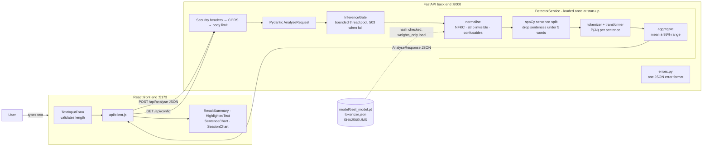

# AI-Generated Content Detector — COS30049 Assignment 3

A full-stack web application that estimates how likely a piece of writing is to be
AI-generated, **sentence by sentence**, with an overall score and a confidence range.
React front end, FastAPI back end, and a transformer trained from scratch in Assignment 2.

**Who it is for:** teachers, editors and moderators who need to decide whether to look
more closely at a piece of writing. It highlights *which* sentences look machine-written,
so the user can review those passages themselves instead of trusting one opaque number.

> Assignment 2 (data, features, model training) is documented in
> [README-assignment2.md](README-assignment2.md).

---

## 1. Running the application

Needs **Python 3.12+** and **Node.js 20.19+ or 22.12+**. Run the back end and the
front end in two terminals, starting from the repository root.

### Back end (http://localhost:8000)

```bash
cd backend
python3 -m venv .venv
source .venv/bin/activate          # Windows: .venv\Scripts\activate
python -m pip install -r requirements.txt
cp .env.example .env               # optional - every setting has a safe default
uvicorn app.main:app --port 8000 --no-server-header
```

The first start checks the model's SHA-256 and loads it once (a few seconds).
API documentation: **http://localhost:8000/docs**

### Front end (http://localhost:5173)

```bash
cd frontend
npm ci                             # installs the exact versions in package-lock.json
cp .env.example .env               # optional - defaults to http://localhost:8000
npm run dev
```

Open **http://localhost:5173**. To serve the production build (with the strict
Content-Security-Policy) use `npm run build && npm run preview` instead.

### Tests

```bash
cd backend
python -m pip install -r requirements-dev.txt
python -m pytest
```

---

## 2. Architecture



**One request, end to end**

1. `TextInputForm` checks the text is non-empty, ≤ 1,000 words and ≤ 8,000 characters
   (usability only), then `api/client.js` sends `POST /api/analyse {"text": "..."}`.
2. Middleware adds security headers, enforces CORS, and rejects bodies over 32 KB (413).
3. `AnalyseRequest` (Pydantic) enforces the same limits for real (422 on failure).
4. `InferenceGate` runs the model on a worker thread, or returns 503 if the server is full.
5. `DetectorService.analyse` normalises the text, splits it into sentences, scores every
   sentence of 5+ words, and combines them into a document score and range.
6. The response (`AnalyseResponse`) goes back to the front end, which shows the score,
   highlights each sentence by band, and updates both charts.
7. Any failure at any step is returned as `{"error": {"code", "message", "details"}}`.

### Folder layout

| Folder | Contents |
|---|---|
| `backend/app/` | `main.py` (wiring), `config.py`, `schemas.py`, `errors.py` |
| `backend/app/routes/` | `analyse.py` (POST), `meta.py` (GET health, config) |
| `backend/app/ml/` | inference-only copy of the model, sentence rules, normalisation, `DetectorService` |
| `backend/app/security/` | model hash check, body limit, inference gate, security headers |
| `backend/model/` | `best_model.pt`, `tokenizer.json`, `SHA256SUMS` |
| `frontend/src/` | `pages/`, `components/`, `api/client.js`, `styles/tokens.css` |
| `security/` | attack scripts, audit reports and measured results |

### API

| Method | Path | Purpose |
|---|---|---|
| `POST` | `/api/analyse` | Score a text. 200, or 413 / 422 / 503 / 500 in the shared error format |
| `GET` | `/api/config` | Input limits and score bands, so front-end validation matches the back end |
| `GET` | `/api/health` | Liveness check that never touches the model (used in the DoS demo) |

Every endpoint has a description and example request/response at `/docs`.

---

## 3. Pinned dependencies

**Back end** (`backend/requirements.txt`): fastapi 0.141.1, starlette 1.6.0,
uvicorn 0.52.1, pydantic 2.13.4, pydantic-settings 2.16.1, numpy 2.4.4, torch 2.13.0,
tokenizers 0.22.2, spacy 3.8.16, en_core_web_sm 3.8.0 (exact wheel URL).
Dev only (`requirements-dev.txt`): pytest 9.1.1, httpx 0.28.1, pandas 2.3.3, pip-audit 2.10.0.

**Front end** (`frontend/package.json`, exact versions, plus `package-lock.json`):
react 19.3.0, react-dom 19.3.0, react-router-dom 7.18.4, recharts 3.10.1,
vite 8.3.4, @vitejs/plugin-react 6.1.2.

---

## 4. Threat model

**Who would attack it?** Mainly people whose AI-written text is being checked: students
submitting essays, content farms posting reviews, or anyone running an influence
campaign who needs text to pass as human. Also anyone who wants to knock the service
over or work out how it decides.

**What do they want?**
1. A false "Human" verdict on AI-generated text (evasion).
2. To learn the model's behaviour by probing it repeatedly, so they can tune text until it passes.
3. To make the detector unavailable to everyone else (denial of service).

**What can they actually do?** They can send any HTTP request straight to the API with
curl or a script, bypassing every front-end check. That includes oversized or malformed
bodies, many requests at once, the most expensive input the limits allow, and text
full of look-alike or invisible Unicode characters that a person cannot see.

**Which section 2.7 risks this design exposes**

| Risk | Applies? | Why |
|---|---|---|
| Denial of service | **Yes** | Running a transformer costs ~10,000× more than sending a request |
| Misconfiguration / vulnerable dependencies | **Yes** | Every web app; FastAPI and Vite set no security headers by default |
| Missing rate limiting | Yes | Anyone can probe the detector; partly covered by the inference gate |
| Unsafe model loading | Yes | `torch.load` uses pickle; covered by the SHA-256 check + `weights_only=True` |
| SQL injection | No | No database: submitted text is never stored (A1 Req 11) |
| Unsafe file upload | No | Text is pasted, not uploaded |
| Command injection | No | The back end never runs a shell command |
| SSRF | No | The back end never makes an outbound request |
| Broken access control | No | No user accounts |

---

## 5. Defences to be marked (section 2.7)

### 5.1 Denial of service — Advanced

*Attack:* inference is slow, so (a) if it ran inside the `async def` endpoint, one
request would block the event loop and freeze every other user, and (b) a burst of
requests would queue without limit.

*Defence* (`backend/app/security/concurrency.py`, `body_limit.py`):
- inference runs on a pool of `INFERENCE_WORKERS` threads, so the event loop stays free;
- at most workers + `INFERENCE_QUEUE` analyses are admitted; the rest get **503 + Retry-After** immediately;
- a per-request timeout returns 503, and the slot is only freed when the work really ends;
- the cost of any single request is capped: 32 KB body (checked while streaming, so chunked
  bodies cannot bypass it), 8,000 characters, 1,000 words, 64 tokens per sentence.

*Demo:* `python security/attacks/dos_burst.py --burst 30`, against a server started with
`DOS_PROTECTION=false` and then with the default settings. First measurement
(MacBook, 30 concurrent maximum-size requests):

| | Without defence | With defence |
|---|---|---|
| `/api/health` while busy, worst | 3,570 ms | 10 ms |
| Burst outcome | 30 × 200, worst 3.6 s | 6 × 200, 24 × 503 within 52 ms |

*Cost:* under load, some genuine users get a 503 and must retry, and at most
2 analyses run at once even if the machine could do more.

### 5.2 Misconfiguration and vulnerable dependencies — Intermediate

*Defence:* security headers on every response (`backend/app/security/headers.py`,
`frontend/vite.config.js`), CORS limited to the front end's exact origin, `/docs` can be
turned off (`ENABLE_DOCS=false`), no server banner (`--no-server-header`), errors never
expose stack traces, model loaded with `weights_only=True` after a hash check, exact pinned
versions. *Evidence:* `pip-audit`, `npm audit` and OWASP ZAP reports before and after,
in `security/audits/` (see its README for the commands).

---

## 6. Advanced security (section 2.8): detection evasion

*Attack* (`security/attacks/evasion_attack.py`): perturb AI essays the detector catches
so they read the same but look different to the model: Cyrillic/Greek homoglyphs,
zero-width characters, fullwidth letters, at rates from 10% to 100% of letters.

*Defence* (`backend/app/ml/normalise.py`): before splitting, apply NFKC, remove invisible
format characters, and map confusable letters to Latin (Unicode Consortium, n.d.-a; n.d.-b).
The number of characters changed is shown to the user.

*Measurement:* evasion success rate = share of caught essays that drop to ≤ 50% (or get
no score at all), measured with normalisation off and on, over the same perturbed texts.

**Status:** TODO — run on 300 essays and record the results table here. A first run on
40 essays showed that simple perturbations raise the score instead of lowering it, so the
attack needs to be made adaptive. See `security/results/`.

*Cost:* genuine Cyrillic or Greek text is converted to Latin look-alikes, so the
detector only suits English (already its stated scope). Normalisation adds < 1 ms per request.

---

## 7. Security hygiene (section 2.3)

| Requirement | How it is met |
|---|---|
| Input never rendered as HTML | Sentences are React text children; no `dangerouslySetInnerHTML` anywhere |
| Size limits on the back end | 32 KB body (middleware), 8,000 characters and 1,000 words (Pydantic) |
| CORS only allows our front end | `allow_origins=[FRONTEND_ORIGIN]`, GET/POST only |
| No secrets in source | All configuration via environment / `.env` (git-ignored); the app has no secrets |

---

## 8. Known limitations and next steps

- TODO: complete before submission.

---

## 9. References

Ramírez, S. (n.d.) *FastAPI documentation*. Available at: https://fastapi.tiangolo.com/ (Accessed: 27 October 2026).

OWASP Foundation (2021) *OWASP Top 10:2021*. Available at: https://owasp.org/Top10/ (Accessed: 27 October 2026).

Unicode Consortium (n.d.-a) *Unicode Standard Annex #15: Unicode normalization forms*. Available at: https://www.unicode.org/reports/tr15/ (Accessed: 27 October 2026).

Unicode Consortium (n.d.-b) *Unicode Technical Standard #39: Unicode security mechanisms*. Available at: https://www.unicode.org/reports/tr39/ (Accessed: 27 October 2026).

Weber-Wulff, D. et al. (2023) 'Testing of detection tools for AI-generated text', *International Journal for Educational Integrity*, 19(1), article 26.

TODO: add the datasets (DAIGT V2 / DRCAT, HC3) and any other sources used.

---

## 10. Use of generative AI

TODO: the team must describe, in its own words, how generative AI was used. For example:
Claude (Anthropic) was used through Claude Code to scaffold the back-end and front-end
structure, draft security middleware and attack scripts, and draft parts of this README.
The team then reviewed, tested and modified the code, and is responsible for it.
