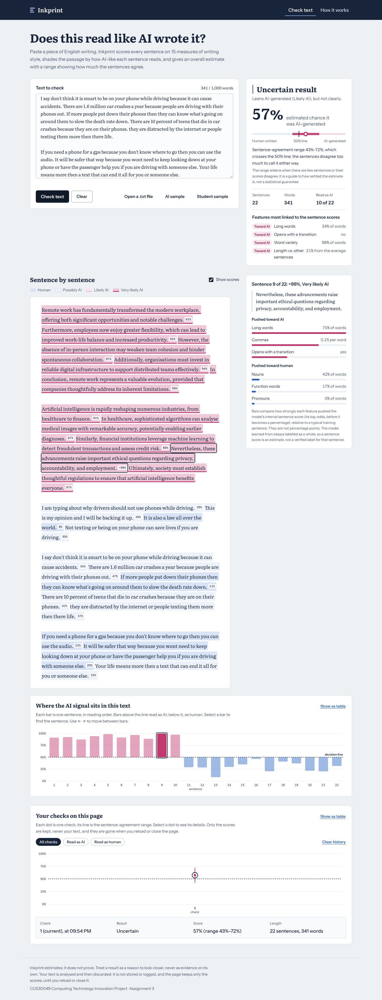
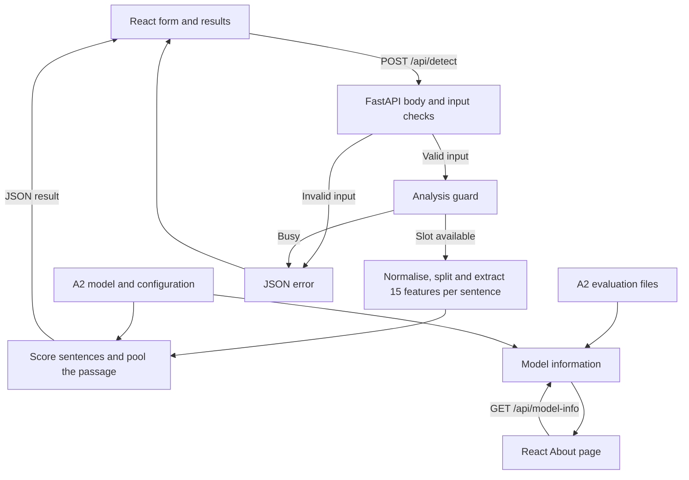

# Inkprint

**AI-generated writing detector | COS30049 Computing Technology Innovation Project | Assignment 3**

Inkprint helps students and educators explore why a passage of English writing resembles the essays in our training data. Paste a passage or open a plain-text file. The app estimates how AI-like the passage reads, highlights individual sentences and shows which writing features influenced each score. The model works best on student essays. A score alone cannot establish authorship.



## 1. Run it

Use **Python 3.15** and **Node.js 20.19+ on the 20.x line, or Node.js 22.12+**. The first installation downloads Python and JavaScript packages and the spaCy English model. The trained classifier is included in `backend/model/`. Open two terminals in **the folder containing this README**, alongside `backend/` and `frontend/`.

### Terminal 1 — FastAPI

**Windows PowerShell**

```powershell
cd backend
py -3.15 -m venv .venv
.\.venv\Scripts\python.exe -m pip install -r requirements.txt
if (!(Test-Path .env)) { Copy-Item .env.example .env }
.\.venv\Scripts\python.exe -m app
```

**macOS or Linux**

```bash
cd backend
python3.15 -m venv .venv
.venv/bin/python -m pip install -r requirements.txt
test -f .env || cp .env.example .env
.venv/bin/python -m app
```

On Windows with Git Bash, use `py -3.15` to create the environment and `.venv/Scripts/python.exe` in place of `.venv/bin/python` in the remaining commands. The `python -m app` entry point starts Uvicorn with the server header and forwarded-header trust disabled.

### Terminal 2 — React

```sh
cd frontend
npm ci
npm run dev
```

`npm ci` installs the versions in `package-lock.json`. The frontend defaults to the local API. To configure another API address, copy `frontend/.env.example` to `frontend/.env` and set `VITE_API_BASE_URL`. The backend reads its settings from the environment or `backend/.env`.

| Open in a browser | What to expect |
|---|---|
| [Inkprint](http://localhost:5173) | Use this exact frontend origin for local development. Choose **AI sample** and **Check text** to run a prediction. |
| [API health](http://127.0.0.1:8000/api/health) | After startup the response contains `"status": "ok"` and `"model_loaded": true`. |
| [Interactive API documentation](http://127.0.0.1:8000/docs) | Expand an endpoint and use **Try it out**. The marking configuration uses `SHOW_DOCS=true`. |

### Tests and build

| Working directory | Command | What it checks |
|---|---|---|
| `backend/`, with the project virtual environment active | `python -m pytest` | The 35 test cases cover API responses, input limits, error handling, model behaviour and security controls. |
| `backend/`, with the environment active and the API running | `python scripts/measure_latency.py --runs 30` | Times the API round trip for 500-word and 1,000-word passages. |
| `frontend/` | `npm run lint` and `npm run build` | Runs ESLint and builds the production frontend. |

If running without activating the virtual environment, use the same Python executable as in Terminal 1. The backend requirements pin the listed packages, including the scikit-learn version used to save the classifier. The English spaCy pipeline is pinned to a release wheel.

### Pinned versions

Every dependency is pinned to an exact version, so the app runs the same way on every machine. The full lists are in [backend/requirements.txt](backend/requirements.txt) and [frontend/package.json](frontend/package.json), with the complete frontend tree locked in [frontend/package-lock.json](frontend/package-lock.json).

| Backend (Python 3.15) | Version | Frontend (Node.js) | Version |
|---|---|---|---|
| FastAPI | 0.162.0 | React and React DOM | 19.2.0 |
| Starlette | 1.10.0 | React Router DOM | 7.18.5 |
| Uvicorn | 0.54.0 | MUI Material | 7.3.4 |
| Pydantic | 2.14.3 | Emotion (react / styled) | 11.14.0 / 11.14.1 |
| pydantic-settings | 2.16.2 | D3 | 7.9.0 |
| scikit-learn | 1.9.1 | Axios | 1.21.0 |
| NumPy | 2.5.4 | Vite | 7.3.7 |
| SciPy | 1.18.1 | @vitejs/plugin-react | 5.1.0 |
| joblib | 1.6.0 | ESLint | 9.38.0 |
| spaCy / thinc | 3.8.18 / 8.3.14 | Literata / Instrument Sans fonts | 5.2.8 |
| en_core_web_sm | 3.8.0 (release wheel) | | |
| pytest / httpx | 9.2.0 / 0.28.1 | | |

## 2. Architecture and the link to Assignment 2



1. **React sends one passage.** The form validates the input. `detectText` sends a JSON object with the single field `text`.
2. **FastAPI admits the request.** Middleware checks the body size, Pydantic checks the text and the analysis guard reserves a slot. An admitted analysis runs in a worker thread.
3. **The A2 model makes the prediction.** FastAPI's startup routine loads the frozen logistic-regression pipeline and the spaCy pipelines once per server process. The app normalises the incoming characters, applies the A2 cleaning and sentence-splitting rules, and builds the same ordered set of nine writing-style features and six part-of-speech features (Honnibal et al. 2020). The scikit-learn classifier returns one probability for each usable sentence (Pedregosa et al. 2011).
4. **React displays the response.** The backend pools the sentence probabilities, returns the passage verdict and provides the text segments used for highlighting. Selecting a sentence links its chart bar, passage highlight and feature explanation.

The classifier, frozen configuration and two evaluation CSVs match the A2 exports byte for byte. The model version shown on the About page is `db04079c0d91`, the first 12 characters of its SHA-256 digest. Our earlier parity check on 16 essays and two accented passages produced the same features and document scores as the original A2 code on those inputs. [Frozen model configuration](backend/model/frozen_config.json)

| A2 evaluation set | Document accuracy | What it tells us |
|---|---:|---|
| DRCAT held-out essays (Kłeczek n.d.) | **88.84%** | Performance on writing similar to the training essays. [DRCAT evaluation](backend/model/test_metrics_drcat.csv) |
| External HC3 question answers (Guo et al. 2023) | **60.55%** | Performance drops on a different writing task. [HC3 evaluation](backend/model/test_metrics_hc3.csv) |

## 3. Where to find the code

| Component | Location |
|---|---|
| Form, request and results | [TextInputForm.jsx](frontend/src/components/TextInputForm.jsx), [API client](frontend/src/api/client.js), [DetectPage.jsx](frontend/src/pages/DetectPage.jsx) |
| Sentence selection and session comparison | [HighlightedPassage.jsx](frontend/src/components/HighlightedPassage.jsx), [SentenceChart.jsx](frontend/src/components/SentenceChart.jsx), [HistoryChart.jsx](frontend/src/components/HistoryChart.jsx) |
| Startup, settings and validation | [main.py](backend/app/main.py), [config.py](backend/app/config.py), [schemas.py](backend/app/schemas.py) |
| Endpoints, error responses and security middleware | [detect.py](backend/app/routers/detect.py), [errors.py](backend/app/errors.py), [security.py](backend/app/security.py) |
| Text preparation, features and model | [text_pipeline.py](backend/app/ml/text_pipeline.py), [features.py](backend/app/ml/features.py), [detector.py](backend/app/ml/detector.py) |
| Tests and recorded experiment inputs | [API tests](backend/tests/test_api.py), [defence tests](backend/tests/test_defences.py), [evaluation samples](backend/scripts/data/samples.json) |

## 4. Using the detector

- **Input.** Paste **20–1,000 words** of English prose or open a `.txt` file up to **100 KiB**. The browser reads the file locally and sends only its text as JSON. The server separately enforces the word limits, a **20,000-character** limit and a **128 KiB** HTTP-body limit. For validation, a word is a whitespace-separated item containing at least one letter or digit.
- **Result.** The main result shows a verdict, estimated AI score and sentence-agreement range. The page shows loading, success and error states. An unknown frontend address opens a 404 page, and an error boundary provides a fallback for a rendering failure.
- **Two chart questions.** The sentence chart answers “Which sentences scored highest in this passage?” Select a bar to examine that sentence. The history chart answers “How do my recent checks compare?” Filter by verdict or select a point for its details. Both charts have tooltips, keyboard controls and a table view (Bostock, Ogievetsky & Heer 2011).
- **Privacy and display.** React renders each segment as text inside a styled element. The API logs the method, path, status and time. It does not persist submitted passages. The current result stays in page memory. The comparison chart retains up to 30 summaries, with scores and counts, for the current browser session. Reloading clears them.
- **Local response time.** In the team's 30-run HTTP benchmark on a two-core machine, a 500-word passage took **57 ms median** and **70 ms at the 95th percentile**. The 1,000-word median was **105 ms**. These timings cover the API round trip. [Measurement script](backend/scripts/measure_latency.py)

## 5. API and interpretation

FastAPI generates the live Swagger UI from the application's routes and Pydantic schemas (Ramírez n.d.). [Open the local API documentation](http://127.0.0.1:8000/docs)

| Method and path | Request | Successful response |
|---|---|---|
| `GET /api/health` | No body | Status and whether the model is loaded. After startup, `{"status":"ok","model_loaded":true}`. |
| `GET /api/model-info` | No body | Model name, version, ordered features, evaluation, threshold, pooling and input limits. For this model the response includes `"threshold": 0.5` and `"pooling": "sqrt_length"`. |
| `POST /api/detect` | JSON containing `text` | `label`, `score`, `range`, `certainty`, per-sentence scores, highlighted passage segments, writing-style contributions and normalisation counts. |

**Example request for `POST /api/detect`**

```json
{
  "text": "Remote work has fundamentally transformed the modern workplace, offering both significant opportunities and notable challenges. Furthermore, employees now enjoy greater flexibility, which can lead to improved work-life balance. However, the absence of in-person interaction may weaken team cohesion."
}
```

To trace the result, submit this passage from the frontend, open the request in the browser's Network tab and compare `score` with the percentage on screen. Select a sentence and compare its bar with the matching entry in `sentences`.

The screenshot at the top shows a different, 341-word passage. Its displayed score is **57%**, with a sentence-agreement range of **43–72%**. Because that range crosses the 50% decision boundary, the headline reads **Uncertain result**. These are the rounded values visible to the user.

**Example validation response.** Submitting `{"text":"one two three"}` returns HTTP `422`.

```json
{
  "error": {
    "code": "validation_error",
    "message": "Text has 3 words; at least 20 are needed for a meaningful score.",
    "fields": [
      {
        "field": "text",
        "message": "Text has 3 words; at least 20 are needed for a meaningful score."
      }
    ]
  }
}
```

Other API outcomes include `400` for malformed JSON, `404` for an unknown route, `405` for the wrong method, `413` for an oversized body, `503` when all analysis slots are occupied or the model is unavailable, and a generic `500` for an unexpected failure. A busy response includes `Retry-After: 2`. Application errors use the JSON structure above. The CORS middleware handles browser preflight responses separately.

**How to read a score.** Each sentence receives an estimated AI probability. For the passage, each sentence's weight is the square root of its word count. Longer sentences therefore have more influence, with a smaller increase in weight for each additional word. A pooled score at or above **0.5** maps to the AI label. The sentence-agreement range widens when sentences disagree or when there are few effective observations. Its calculation uses weighted variance and effective sample size (Kish 1965). Its coverage as a statistical confidence interval has not been validated. A range spanning the decision boundary produces an **Uncertain result**.

Each sentence inherited its training label from its essay. The feature explanation shows how strongly an individual feature pushed a sentence's log-odds towards AI or human writing. This explains the model's behaviour on a sentence without establishing who wrote it.

## 6. Threat model

A writer may want an AI-generated passage to receive a human verdict. Someone probing the service can repeatedly edit and resubmit text to learn which features affect the score. A third user may want to keep the detector busy so other people cannot use it. All three can call the API directly, choose the text and headers they send, and issue concurrent requests. Browser validation alone cannot enforce server limits. These capabilities guided the scope of our defences (Dong 2026a, 2026b).

| Risk in this app | Why it matters or where the boundary lies |
|---|---|
| Denial of service | Text cleaning, spaCy analysis and model inference consume CPU. A small input or a burst can delay other users. Nominated in §7A. |
| Misconfiguration and vulnerable dependencies | The application depends on Python and JavaScript packages and serves responses from two local origins. Nominated in §7B. |
| Detection evasion | Unicode edits can change model features in text that looks similar to a reader. Nominated in §8. |
| Repeated probing and model loading | The concurrency cap limits simultaneous work. It does not impose a per-user rate limit. Startup trusts the bundled local model. Its displayed hash identifies the artefact and is not an integrity check against a trusted digest. |
| Other risks in the brief | The service has no database, accounts or stored user records. The API accepts JSON text, does not save client-supplied filenames, does not run shell commands from text and does not fetch URLs supplied by users. |

## 7. Nominated security defences — assignment §2.7

We nominate **denial of service (Advanced)** and **misconfiguration and vulnerable dependencies (Intermediate)**.

### 7A. Denial of service

The A2 HTML-cleaning expression could spend several seconds backtracking on a small input. Running that work on the API event loop delayed unrelated requests. We changed the cleaner to a linear expression, moved inference to a worker thread and limited concurrent analyses to four per server process. Excess requests receive `503` immediately. The regression tests compare the two cleaners' output on a fixed sample of 20,000 generated strings (Weidman n.d.). [Cleaning code](backend/app/ml/text_pipeline.py) · [Analysis guard and route](backend/app/routers/detect.py) · [Defence tests](backend/tests/test_defences.py)

| Team measurement on localhost | Defence off | Defence on |
|---|---:|---:|
| Longest wait for an unrelated health request during one expensive analysis, original benchmark | 4,828 ms | 4 ms |
| Same measurement in a second team run | 8,467 ms | 20 ms |
| Outcomes for 30 concurrent analyses in the second run | 30 completed with `200` | 4 completed with `200` and 26 received `503` |

Both timing rows describe the longest wait within their own run. The trade-off is that legitimate users can also receive a busy response during a burst. The frontend offers a retry after the wait. The included comparison uses the local service and the same workload for both settings. [Local comparison script](backend/scripts/attacks/dos_attack.py)

The local demonstration uses `DOS_GUARD_ENABLED` in `backend/.env`. The default is `true`. Restart the backend after changing the setting so each run uses the intended configuration.

### 7B. Misconfiguration and vulnerable dependencies

| Recorded finding | Change in this version |
|---|---|
| The team's frontend audit flagged older Axios, React Router and Vite versions. | Axios `1.13.1 → 1.21.0`, React Router DOM `7.9.5 → 7.18.5` and Vite `7.1.12 → 7.3.7`. [Frontend manifest](frontend/package.json) · [Lockfile](frontend/package-lock.json) |
| The Python audit flagged older Starlette and pytest versions. | Starlette `0.49.3 → 1.10.0` and pytest `8.4.2 → 9.2.0`. FastAPI is pinned at `0.162.0`. [Backend requirements](backend/requirements.txt) |
| The server advertised its software and accepted forwarded headers under the previous launch settings. | The project entry point disables both behaviours. [Server entry point](backend/app/__main__.py) |
| API responses needed browser security headers and cache controls. | The middleware adds `nosniff`, frame restrictions, a referrer policy and a permissions policy. API routes also receive a restrictive content security policy and `Cache-Control: no-store`. These settings apply to responses served by FastAPI. [Security middleware](backend/app/security.py) |
| Browser access and documentation exposure needed explicit settings. | CORS allows the configured frontend origin and covers early body-limit responses. `SHOW_DOCS` controls the live API documentation and schema. Local credentials belong in backend environment settings. `VITE_` variables are visible to the browser. [Application setup](backend/app/main.py) · [Example settings](backend/.env.example) |

**Dependency audit evidence.** The team's recorded follow-up reported zero known findings for the packages checked by `npm audit` in `frontend/` and `pip-audit -r requirements.txt` in `backend/`. The English spaCy model was outside the Python audit's coverage and is pinned to an exact release URL. The successful terminal exports and tested revision have not been supplied with this version. The earlier `ENOLOCK` screenshot records an invocation from the wrong directory.

**OWASP ZAP evidence.** The recorded backend attempt started at `http://127.0.0.1:8000/` and received `404`. The API provides a health check at `/api/health`. The team reported reaching the frontend on port 5173. [ZAP Report](ZAP_Reports/2026-11-11-ZAP-Report-.html)

**Cost.** Package upgrades require compatibility checks. Restrictive frame headers prevent embedding the API in another site. The frontend and API serve different responses, so each origin needs its own scan evidence.

## 8. Advanced security — detection evasion, assignment §2.8

Our selected model attack is **detection evasion**. Invisible or look-alike characters can change the word boundaries and writing-style features seen by the A2 classifier while leaving a passage visually similar. The backend performs targeted Unicode normalisation before the original feature extraction and reports how many characters it changed. The mapping covers selected cross-script look-alikes described by the Unicode Consortium (Davis & Suignard 2023). [Normalisation code](backend/app/ml/text_pipeline.py) · [Evaluation script](backend/scripts/attacks/evasion_attack.py)

All **10 original AI passages** scored at or above 0.5 before any edit. A successful evasion moved one of those passages below 0.5. Deterministic variants ran once per passage. Random variants used five seeds per passage, giving 50 variants from the same 10 sources. The team's experiment record reports matching results in-process and through the local `POST /api/detect` endpoint. For the HTTP comparison the team changed `EVASION_DEFENCE_ENABLED`, restarted the API and used the same samples each time.

| Edit | Variants | Success with defence off | Success with defence on | Mean AI score off → on |
|---|---:|---:|---:|---:|
| Unedited AI passages | 10 | — | — | 0.905 → 0.905 |
| Zero-width spaces | 10 | 100% | 0% | 0.314 → 0.905 |
| 10% look-alike substitutions | 50 | 0% | 0% | 0.774 → 0.905 |
| 30% look-alike substitutions | 50 | 60% | 0% | 0.486 → 0.905 |
| 100% look-alike substitutions | 10 | 100% | 0% | 0.069 → 0.905 |
| Combining marks | 10 | 100% | 0% | 0.187 → 0.905 |
| Mixed invisible and look-alike edits | 50 | 100% | 0% | 0.171 → 0.905 |
| Visible edits to punctuation and transition words | 10 | 0% | 0% | 0.777 → 0.777 |

**Cost and limits.** On the team's controls, the largest score change was 0.0000 across 10 unedited AI passages, six human essays and two passages containing precomposed accented characters. A passage containing genuine Greek and Cyrillic text changed by **0.0232**. A separately encoded accent can also be removed. The teammate's timing run measured **1.73 ms for normalisation on 692 words**. Visible rewriting still affected scores with the defence enabled. These results cover the listed variants and ten original AI passages. [Sample provenance](backend/scripts/data/samples.json)

## 9. Known limitations

- The classifier was trained on English essays. The external HC3 results in §2 show how much accuracy can fall on another genre. Per-sentence scores also inherit the limitations of essay-level training labels.
- Each server process maintains its own concurrency counter. A multi-process deployment would need coordinated limits. One client can repeatedly occupy available slots.

## 10. References

Bostock, M, Ogievetsky, V & Heer, J 2011, ‘D³: data-driven documents’, *IEEE Transactions on Visualization and Computer Graphics*, vol. 17, no. 12, pp. 2301–2309. [doi:10.1109/TVCG.2011.185](https://doi.org/10.1109/TVCG.2011.185)

Davis, M & Suignard, M (eds) 2023, *Unicode security mechanisms*, Unicode Technical Standard #39, rev. 28, Unicode Consortium, viewed 11 November 2026. [Version 15.1.0](https://www.unicode.org/reports/tr39/tr39-28.html)

Dong, R 2026a, ‘The back end, and how it gets attacked’, *COS30049 Computing Technology Innovation Project*, Week 10 lecture slides, Swinburne University of Technology, Semester 2.

Dong, R 2026b, ‘When the model itself leaks’, *COS30049 Computing Technology Innovation Project*, Week 11 lecture slides, Swinburne University of Technology, Semester 2.

Guo, B, Zhang, X, Wang, Z, Jiang, M, Nie, J, Ding, Y, Yue, J & Wu, Y 2023, ‘How close is ChatGPT to human experts? Comparison corpus, evaluation, and detection’, *arXiv*, 2301.07597. [arXiv](https://arxiv.org/abs/2301.07597)

Honnibal, M, Montani, I, Van Landeghem, S & Boyd, A 2020, *spaCy: industrial-strength natural language processing in Python*, software, Zenodo. [doi:10.5281/zenodo.1212303](https://doi.org/10.5281/zenodo.1212303)

Kish, L 1965, *Survey sampling*, John Wiley & Sons, New York.

Kłeczek, D n.d., *DAIGT V2 train dataset*, dataset, Kaggle, viewed 11 November 2026. [Dataset](https://www.kaggle.com/datasets/thedrcat/daigt-v2-train-dataset)

Pedregosa, F, Varoquaux, G, Gramfort, A, Michel, V, Thirion, B, Grisel, O, Blondel, M, Prettenhofer, P, Weiss, R, Dubourg, V, Vanderplas, J, Passos, A, Cournapeau, D, Brucher, M, Perrot, M & Duchesnay, É 2011, ‘Scikit-learn: machine learning in Python’, *Journal of Machine Learning Research*, vol. 12, pp. 2825–2830. [Journal article](https://jmlr.org/papers/v12/pedregosa11a.html)

Ramírez, S n.d., *First steps*, FastAPI documentation, viewed 11 November 2026. [FastAPI](https://fastapi.tiangolo.com/tutorial/first-steps/)

Weidman, A n.d., *Regular expression denial of service – ReDoS*, OWASP Foundation, viewed 11 November 2026. [OWASP](https://community.owasp.org/attacks/Regular_expression_Denial_of_Service_-_ReDoS)

ZAP Dev Team n.d., *Alerts*, ZAP desktop user guide, viewed 11 November 2026. [ZAP documentation](https://www.zaproxy.org/docs/desktop/start/features/alerts/)

## 11. Generative AI statement

We used Anthropic's Claude to help draft the web application, tests and security evaluation scripts using our Assignment 2 code, the Assignment 3 brief and the unit materials. The human control passages came from the labelled DRCAT dataset. The benchmark file records the origin of each group of samples.

The project uses our frozen A2 classifier and its evaluation files. Our documented checks include comparing features and predictions against A2 on 16 essays and two accented passages, and comparing local defence-off and defence-on runs under the same conditions. The scripts and tests linked above show how those behaviours are checked.

